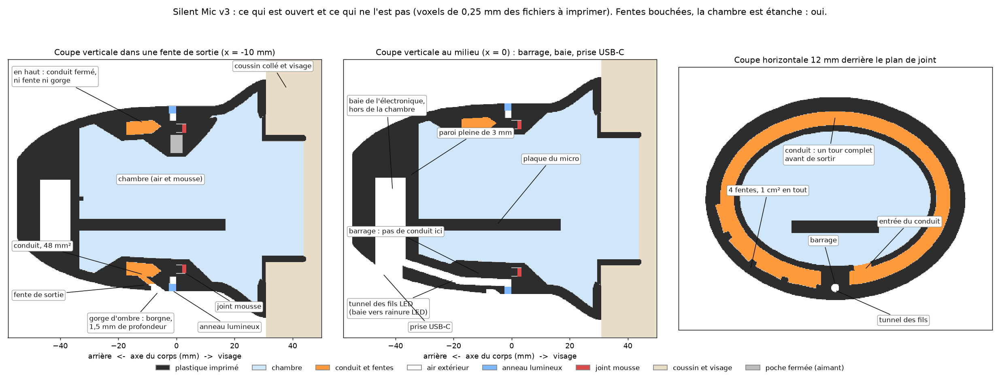
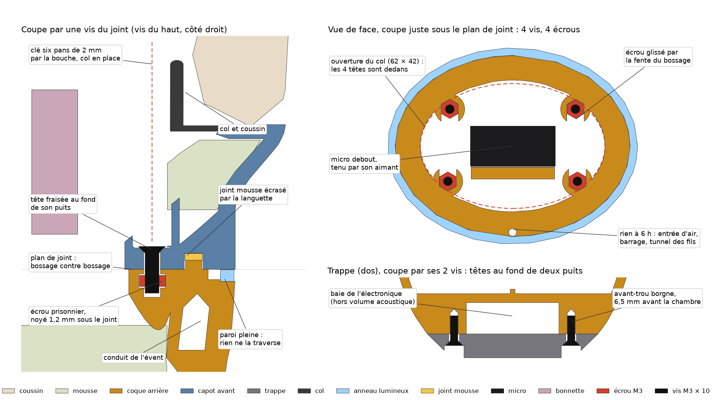
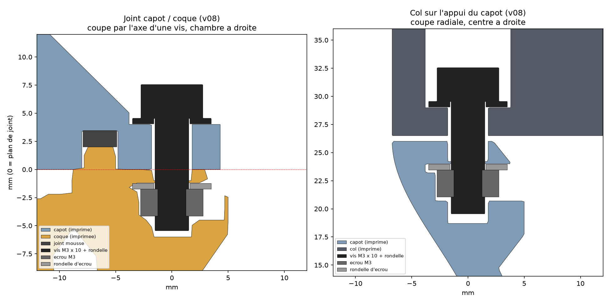

# Silent Mic v3 galet : impression et montage

État au 23 novembre 2026. Rien n'est encore imprimé : temps et masses viennent du tranchage Bambu Studio, le montage vient de la CAO (`cad/silent_mic_v3_galet.py`).

> **Assemblage vissé depuis le 23 novembre 2026.** Décision de Clément : tout ce qui ne s'ouvre pas au quotidien se visse, pour tenir, pour fermer le joint à coup sûr et pour qu'on ne démonte pas l'appareil par mégarde. Le capot avant se serre sur la coque par 4 vis M3 fraisées à écrous prisonniers (mêmes cotes que le v2), la trappe par 2 vis. Seul le micro tient par son aimant : il entre et sort par la bouche, capot en place. Les 12 aimants et 12 pastilles du joint et de la trappe disparaissent.
>
> **Appui visage révisé le 23 novembre 2026.** Clément a essayé sa bouche sur le v2 imprimé : coussin écrasé d'environ moitié (28 à 15 mm), ses lèvres descendent un peu sous le fond du coussin. Le v3 avait perdu trois choses du v2 (`cad/whisper_mask_v0.py`) : l'assise creusée qui fait épouser les joues au coussin, la règle des 8 mm d'air entre le fond du coussin et le micro, et un bord rigide plus bas. Corrigé ainsi :
> 1. **Assise courbe rapportée** (`cp.saddle_collar`) : une pièce posée à plat sur l'appui du capot avant et collée au ruban double face, comme le coussin. Son dessus est creusé en cylindre de 105 mm de rayon, comme le v2 : 4 mm d'épaisseur au centre, les côtés avancent vers les joues jusqu'à 13,8 mm de plus au bord. Le capot avant ne change pas.
> 2. **Col bombé d'une pièce avec l'assise** : sa crête suit la courbe, 10 mm au-dessus du fond du coussin au centre, là où est la bouche, et plus haut sur les côtés (idée de Clément). Essai de Clément du 24 nov. 2026 sur l'assise de 10 mm : taille juste, mais pas assez courbée et col trop bas. Variantes d'essai : col de 20 mm, rayons de 85 et 70 mm au lieu de 105. Sur la R85, Clément a relevé les bords par deux paires de cales de 12 mm, puis validé la courbure à l'essai (« c'est vraiment ce qu'on veut »). **Assise du corps depuis le 24 nov. 2026** (`cp.BODY_SEAT`, plateau `print/corps-assise.3mf`) : la même d'une pièce, dessus au rayon de 53 mm (bords 24 mm plus haut qu'avec la R85), col à 20 mm au-dessus de l'assise partout, qui remonte avec elle sur les côtés (demande de Clément). Les cales empilées finissaient en lame presque coupante : le dessus se prolonge en droite au-delà de 60° de pente et toute l'arête du haut du contour est arrondie de 2 mm (Clément voulait des bords bien arrondis dans l'épaisseur comme dans la largeur). La pointe culmine à 35,4 mm au lieu de 45,8 avec les cales ; c'est une lèvre ronde de 3,5 mm d'épais à 1 mm sous son sommet, 4,9 mm à 3 mm (2,1 et 2,9 mm avec un arrondi de 1 mm). La courbure est la même jusqu'à 46 mm du centre, donc sous toute la ligne d'appui du coussin (45 mm). Vu de face, le contour reste une ellipse : rayon de 28,5 mm aux pointes, aucun angle. La crête du col est un demi-rond complet sur ses 2 mm d'épaisseur. Même dos plat et même contour : elle se colle sur le capot sans rien y changer.
> 3. **Micro descendu de 20 mm, au fond de la chambre** : il tient sur son disque, 1 mm au-dessus des nervures du fond, et les deux couches de mousse sont entaillées autour de lui. Le disque d'acier de 30 mm se recoupe d'une bande de 10 mm en bas, toute sous le bas du micro : la surface sous l'aimant ne change pas. Avec la bonnette à la cote mesurée (48 mm du bas du micro au haut des poils), le haut des poils serait à 18 mm sous le fond du coussin au centre, à longueur égale. `export()` refuse le modèle sous 8 mm.
> 5. **Capot avant raccourci de 5 mm** (décision de Clément, meilleur compromis compacité / isolation) : le corps passe à 81 mm, 100,7 mm avec l'assise et le col (105,7 avant). La chambre perd 18 cm³ : 21,2 dB(A) au modèle 1D au lieu de 22,2 (estimation, non mesurée). Le haut des poils reste à 13 mm sous le fond du coussin, 5 mm de mieux que la règle du v2. Avec l'assise R53 du 24 nov. 2026, le corps garde 81 mm, mais ses bords montent : 120,8 mm aux pointes des joues (100,7 avant). Le col de 20 mm ajoute 22 cm³ à la chambre et ferme toute la paroi souple du coussin : 25,1 dB(A) au modèle 1D au lieu de 21,2 (estimation, non mesurée).
>
> 4. **Coussin aux cotes mesurées par Clément** (108 × 81 mm, ouverture 72,6 × 48,5, 28 mm d'épaisseur, contre 110 × 90 × 30 sur la fiche) : l'appui du capot passe de 104 × 84 à 104 × 77 mm, 2 mm sous le coussin de chaque côté, et le col suit la vraie ouverture (1 mm de jeu par côté, passage intérieur 66,6 × 42,5).
>
> Le micro couché, envisagé, ne passe pas : dans un sens, ses 48 mm de long heurtent les 4 bossages de vis du joint ; dans l'autre, il ne ressort plus par le col (42 mm de haut).

> **Support du micro repris le 21 novembre 2026.** Le micro est debout contre une plaque dressée au centre du fond, comme sur le v2, haut du boîtier vers la bouche, bonnette DJI en place (décision de Clément). Le capot avant se pose droit, et le micro coiffé de sa bonnette passe droit par la bouche (contrôlé dans la CAO, sur les fichiers d'impression et dans Onshape). Une seconde relecture indépendante a confirmé le démontage et l'étanchéité, et fait abaisser la plaque sous la bonnette. Clément a confirmé le 21 novembre 2026 que la jupe de sa bonnette DJI descend de moins de 9 mm sur le dos du micro et qu'elle est très molle : elle s'écrase au besoin. L'ancien pied, près de la paroi basse, bloquait le capot : voir « Relecture indépendante du 21 novembre 2026 ».

## Impression

Bambu Lab A1 mini, buse 0,4 mm, couches de 0,20 mm, 4 périmètres, 20 % de remplissage (100 %, en rectiligne, pour les pièces qui ferment la chambre du corps : assises, capot avant, coque arrière), couture alignée, plaque PEI texturée. PLA : préréglage « ELEGOO PLA Mat Flow Rate Calibrated » de Clément (débit 1,029, densité 1,32). PETG : « Bambu PETG Translucent @BBL A1M ». Fichiers dans `cad/out/v3-galet/`.

> **Pièces pleines depuis le 23 novembre 2026** (question de Clément sur les 20 %). Le modèle 1D ne voit pas d'effet de la paroi : 4 fois moins raide, l'isolation reste à 25,1 dB(A), et 10 fois moins raide elle ne perd que 0,4 dB(A) ; les fuites du joint et l'évent dominent (estimation, non mesurée). Les parois de 3 mm sortent de toute façon pleines (4 périmètres de chaque côté) : le remplissage ne change que les zones épaisses. Une pièce pleine coûte peu et retire ce doute : plus de vide entre les périmètres, plus de peau mince qui vibre. Depuis le 24 novembre, la trappe est pleine aussi : Clément veut le poids et la sensation d'un produit fini. Appareil complet d'environ 310 g en plein (pièces imprimées 268 g d'après le trancheur, composants environ 40 g), 220 g à 20 %. Les éprouvettes de joint et le capot d'essai gardent 20 % : ils servent à la forme.

> **Projets 3MF refaits le 23 novembre 2026.** Jusque-là, `cad/bambu_3mf.sh` passait à la ligne de commande les préréglages système de la machine et du procédé sans leur chaîne d'héritage. Les fichiers embarquaient donc une configuration générique : G-code de démarrage réduit à un retour à l'origine (sans la séquence de l'A1 mini : chauffe, nivellement, purge), parois à 60 mm/s, accélérations de 500 mm/s². Et à l'ouverture dans Bambu Studio, l'interface rechargeait le procédé standard en ignorant les 4 parois, les 20 % de remplissage et les supports. Les deux défauts sont corrigés : préréglages aplatis avec tout leur héritage, et écarts au procédé système inscrits dans le projet comme le fait l'interface. Les temps ci-dessous sont ceux du vrai profil A1 mini.

### Pièces d'essai : projets Bambu Studio prêts à imprimer

Dans `print/`, trois projets 3MF tranchés, réglages embarqués. Chaque plateau est d'abord tranché avec supports automatiques (« ne pas supporter les ponts ») pour voir ce que le trancheur réclame : rien pour le capot d'essai, les cols et la lumière ; un plot de 3 mm sous chacune des deux têtes de vis de l'éprouvette de joint avant, posé sur le plateau comme au corps. Ils se rouvrent et se retranchent à l'identique en ligne de commande. On les ouvre dans Bambu Studio (il affiche une fenêtre « Préréglage personnalisé » parce que le filament est le tien : valider), on vérifie dans l'onglet Supports que « Activer les supports » et « Sur plateau uniquement » sont cochés pour le plateau des éprouvettes et celui du capot avant, et « Boucles de paroi » à 4 dans l'onglet Résistance, puis on lance. Régénération : `cad/bambu_3mf.sh` (lit le préréglage de Clément sans le modifier).

| Plateau | Fichier | Contenu | Temps | Filament |
|---|---|---|---|---|
| 1 | `print/capot-essai.3mf` | capot d'essai du coussin et témoin de bonnette | 1 h 51 | 71 g PLA |
| 2 | `print/cols-et-joint.3mf` | assise courbe et col de 10 mm (celle du corps), éprouvettes de joint avant et arrière (2 vis, 2 écrous) ; assise pleine | 1 h 53 | 66 g PLA |
| 2 bis | `print/assises-20mm.3mf` | assises à col de 20 mm, plus courbées (rayons 85 et 70, gravés dessous), essai de forme à 20 % de remplissage : la retenue sera réimprimée pleine | 2 h 15 | 76 g PLA |
| 2 ter | `print/cales-assise.3mf` | deux cales posées sur l'assise R85 déjà imprimée, une de chaque côté sous le coussin : bord relevé de 12 mm (dessus au rayon 60, 3,9 mm contre le col, rien au centre), au lieu de réimprimer l'assise | 40 min | 12 g PLA |
| 2 quater | `print/cales-assise-2.3mf` | seconde paire de cales, posée sur la première : encore 12 mm au bord, 24 au total (dessus au rayon 53, 2,1 mm de plus contre le col, rien avant 27 mm du centre) | 36 min | 9 g PLA |
| 3 | `print/lumiere-petg.3mf` | éprouvette de lumière | 10 min | 1 g PETG |

L'assise se pose à plat sur le capot d'essai comme sur le corps : leurs appuis ont le même contour (104 × 77 mm, 2 mm sous le coussin de chaque côté). Elle s'imprime dos au plateau, sans support (contrôlé couche par couche). Sa hauteur de col est gravée dessous.

**Témoin de bonnette** (sur le plateau du capot d'essai, idée de Clément) : un plot ovale de 36 × 26 mm, haut de 19 mm, marqué « 13 ». Posé au fond du capot d'essai, centré sous le col, son dessus est exactement où sera le haut de la bonnette dans le corps : 13 mm sous le fond du coussin. Assise et coussin en place, appuyer le visage comme pour parler. Si les lèvres touchent le plot, elles toucheraient la bonnette. Pour mesurer la marge, glisser des cales dessous (pièces de monnaie, rondelles) jusqu'au contact : leur épaisseur est la marge. `export()` refuse le corps si sa marge s'écarte du témoin.

Grammes calculés par Bambu Studio avec la densité réelle du filament (1,32) : le tableau OrcaSlicer précédent comptait 1,24, d'où environ 6 % de moins.

### Corps : un seul projet pour la vague d'impression

**Un seul projet, numéroté** (demande de Clément, 24 puis 26 nov. 2026) : `print/silent-mic-vNN.3mf`, le plus grand numéro est la dernière version, la seule à ouvrir. Chaque livraison crée le numéro suivant (`cad/bambu_projet.py`). Toutes les pièces imprimées y sont, une plaque chacune, dans l'ordre du montage, du visage au dos ; on coche les plaques à imprimer. Les réglages de chaque pièce y sont déjà, par objet : pleine, supports sur plateau seulement pour la coque et le capot. Version 4 : 26 nov. 2026 (diamants coniques du col, capot retourné, témoin). Version 6 : 26 nov. 2026 au soir (capot sans paroi dans le vide, écrous du col noyés à 2 mm, la buse contourne les vides : voir « Surplombs et fils »). Version 7 : 27 nov. 2026 (vis à tête cylindrique de la boîte de Clément, rondelle sous la tête et sur l'écrou : voir « Monter »). Version 8 : 27 nov. 2026 (fond des puits de tête du capot enfin plat : la v07 y gardait une rainure de 3,6 mm, reste d'une astuce de pont, qui ôtait à la rondelle la moitié de son appui ; éprouvettes du joint en plaque 7, à serrer avant d'imprimer la coque). Version 9 : 27 nov. 2026 (vis M3 × 12 de la boîte de Clément au lieu de M3 × 10, qu'il n'a pas : perçages du joint 2 mm plus profonds dans la coque, portée des rondelles du col montée de 2 mm, trappe à fond plat pour têtes cylindriques, éprouvette côté écrou épaissie à 10 mm ; plus de rondelle sur l'écrou du joint, niveau de rondelle du col porté de 0,8 à 1,1 mm ; essai du 27 nov. sur la v08 : l'écrou entre et ne tourne pas, la rondelle d'écrou coinçait et faisait céder la languette au-dessus d'elle). Version 10 : 27 nov. 2026 (languette du joint amincie à 2,4 mm et recentrée vers l'intérieur, rainure de 3,1 mm : 0,35 mm de jeu par côté au lieu de 0,2, entrée de la rainure élargie de 0,2 mm sur la première couche ; appui extérieur entre la rainure LED et la rainure porté de 0,9 à 1,0 mm. À l'essai de l'éprouvette v08, la languette butait à l'entrée, sur la première couche écrasée du capot imprimé joint au plateau, et le capot basculait vers les vis autour de cet appui trop étroit, comme Clément l'a vu ; gabarit de la mousse du joint recalé). Version 11 : 27 nov. 2026 (dessus des 4 bossages d'écrou de la coque fermé jusqu'au bord, comme Clément le demandait : jusqu'à la v10, la peau au-dessus de la fente s'arrêtait à 3,3 mm de l'axe et laissait une encoche ouverte, par crainte d'un pont de 5,8 mm sur des parois amincies ; ce pont s'imprime sans peine et l'écrou passe toujours par le côté). Le capot v05 déjà imprimé reste utilisable avec la coque et le col v07 : ses têtes portent sur le bord de leur fraisure, sans rondelle (puits de 6,6 mm), à serrer modérément ; le capot v08 (1 h 50) prend les rondelles à plat (celui de la v07, jamais imprimé, avait la rainure au fond des puits).

| Plaque | Pièce | Temps | Filament |
|---|---|---|---|
| 1 | col (assise R53 et col de 20 mm, vissé sur le capot, 4 logements coniques dessous) | 2 h 21 | 82 g PLA noir |
| 2 | capot avant, imprimé retourné (joint sur le plateau), sans aucun support ; 4 diamants coniques et 4 logements d'écrou et de rondelle du col | 1 h 50 | 56 g PLA noir |
| 3 | anneau lumineux, bobine blanche (Bambu PLA Basic) ; épaisseur à choisir sur l'éprouvette de lumière | 9 min | 2 g PLA blanc |
| 4 | coque arrière (supports sous le passage de la prise USB-C, dans la baie) | 3 h 25 | 112 g PLA noir |
| 5 | trappe | 29 min | 16 g PLA noir |
| 6 | témoin du col : bande d'appui du capot avec ses 4 diamants et bas du col avec ses logements, découpés dans les vraies pièces, à monter à la main | 34 min | 14 g PLA noir |
| 7 | éprouvettes du joint : un tronçon de coque (2 logements d'écrou sans rondelle depuis la v09, membranes, avant-trou de trappe dessous) et un tronçon de capot (2 puits de tête à fond plat), imprimés dans le sens des vraies pièces, sans support ; à serrer avant d'imprimer la coque | 34 min | 14 g PLA noir |

L'anneau est en filament 1, comme le reste : on change de bobine avant la plaque 3 (la ligne de commande de Bambu Studio 2.9 plante quand un projet mélange deux filaments). Seules pièces imprimées du corps : ces quatre plaques et l'assise, déjà imprimée le 24 novembre ; tout le reste de la vue « Montage » s'achète ou se découpe (micro, disque, coussin, mousses, joint, filament LED, électronique, vis et écrous).

Orientations vérifiées le 24 nov. 2026 en tranchant chaque coque dans les deux sens. Capot avant, appui du coussin sur le plateau : 4 colonnes de support dans les puits de vis, 3 g et 10 min ; retourné, face de joint au plateau, le trancheur réclame environ 1 500 blocs de support dans la chambre, impossibles à retirer, ou laisse les surplombs intérieurs dans le vide. Coque arrière, dos au plateau : 0,3 g de support sous le passage de la prise USB-C ; retournée, 9 à 11 g de plus et 26 min de plus.

**Surplombs et fils (26 nov. 2026, capot v05 imprimé).** La pièce est bonne, mais elle montrait des fils fins dans la chambre et des lamelles affaissées sous le bord de l'ouverture, sur les flancs plats. Le G-code de chaque plaque a été relu couche par couche (scripts hors dépôt : parois en surplomb, ponts, déplacements au-dessus du vide) :

- **Ouverture du capot** : sous le pied du siège conique, l'ouverture était droite sur 0,8 mm, et le chanfrein de soutien s'arrêtait 0,9 à 1,2 mm en retrait. Les premières boucles de la plaque étaient posées dans le vide sur tout le tour (370 mm de paroi en surplomb à la couche 23,2). L'ouverture s'évase maintenant à 52° sous le pied, parallèle au chanfrein, 0,1 mm devant lui : la marche tombe à 0,2-0,3 mm, la pente normale d'une couche, et le trancheur n'y voit plus de surplomb.
- **Bossages d'écrou du col, sous l'appui** : leur dessous plat démarrait à moitié dans le vide (5 boucles en l'air à la couche 19,2). Ils ont un pied conique à 52°, sans surplomb.
- **Autres pièces** : rien de semblable. Col : plafonds des 4 logements de diamant et gravure « 20 R85 », des ponts courts prévus. Coque arrière : faîte du conduit, plafonds des logements d'écrou et plafond de la baie de l'électronique (pont de 34 mm, caché par la trappe, hors du volume acoustique). Anneau et trappe : aucun pont ni surplomb.
- **Fils** : la buse traversait les vides entre îlots de matière (cavité, bossages). « Éviter de traverser les parois » est activé sur toutes les plaques (`cad/bambu_3mf.sh`). Distance parcourue au-dessus du vide, de v05 à v06 : capot 59,5 à 35,4 m (−40 %), col 66,8 à 42,5 m (−36 %), coque arrière 77,9 à 61,5 m (−21 %), pour 3 à 7 minutes d'impression de plus par pièce. Une bobine restée à l'air plusieurs jours fait plus de fils : la sécher si besoin.
- **Nettoyage d'une pièce v05** : tirer les fils, couper les lamelles qui pendent avec un ébavureur, sans creuser la plaque ; vérifier qu'une vis descend au fond de chaque puits et qu'un écrou entre dans chaque logement.

Pour lancer une plaque :
1. Imprimante allumée, plateau propre, au moins 115 g de filament noir sur la bobine pour la plaque 4 (coque arrière).
2. Bambu Studio : Fichier > Ouvrir projet > `print/silent-mic-vNN.3mf` au plus grand numéro. S'il demande d'enregistrer le projet précédent : « Non ». Avertissement d'imprimante non connectée : « Plus tard ».
3. Onglet Aperçu, cliquer la vignette de la plaque à gauche (1, 2 ou 3), puis « Trancher le plateau » en haut à droite. Vérifier la durée et la masse du tableau.
4. « Imprimer plateau » (pas « Imprimer tout »), puis « Envoyer ».

### Corps : projets Bambu Studio prêts

| Plateau | Fichier | Contenu | Temps | Filament |
|---|---|---|---|---|
| 4 | `print/corps-capot-avant.3mf` | capot avant, appui du coussin sur le plateau, 4 colonnes de support, plein | 1 h 52 | 56 g PLA |
| 5 | `print/corps-coque-arriere.3mf` | coque arrière, face arrière sur le plateau, pleine | 3 h 13 | 108 g PLA |
| 5 bis | `print/corps-assise.3mf` | assise du corps (R53, col de 20 mm, gravée « 20 R53 » dessous), dos au plateau, sans support, pleine | 2 h 17 | 87 g PLA |
| 6 | `print/corps-trappe.3mf` | trappe, pleine | 29 min | 16 g PLA |
| 7 | `print/corps-anneau-petg.3mf` | anneau lumineux | 11 min | 2 g PETG |

Mêmes réglages que les pièces d'essai. Le corps ne s'imprime qu'après le test de l'assise sur le capot d'essai (`bench/README.md`) et l'essai des éprouvettes de joint. Régénération : `cad/bambu_3mf.sh corps`.

Supports, toujours réglés sur « Sur plateau uniquement » (rien dans une cavité fermée ni dans un logement d'écrou) :

- **Capot avant : aucun**, depuis qu'il s'imprime joint sur le plateau (26 nov. 2026) : la portée de chaque rondelle est le fond plat de son puits, imprimé par-dessus.
- **Coque arrière : sous le passage de la prise USB-C**, dans la baie cachée par la trappe (de 0,2 à 10,4 mm de haut). En automatique, le trancheur en poserait aussi dans les fentes de sortie et sous les plafonds des logements d'écrou, où on ne pourrait pas les retirer.

Sans support, par dessin : au-dessus de chaque écrou, le plafond de son logement (coque : pont de 5,8 mm sur l'écrou seul depuis la v09, qui couvre toute la fente jusqu'au bord du bossage depuis la v11) ou du logement de sa rondelle (col : pont de 7,6 mm) est un pont dont la première couche, de 0,2 mm, reste pleine. La rondelle y porte sur toute sa surface ; cette membrane se perce au montage (jusqu'en v06, une fente de 3,6 mm dans cette couche donnait un trou propre mais laissait à l'écrou 6,5 mm² d'appui au lieu de 16). Les avant-trous de la trappe finissent en pointe.

## Contrôles avant impression

Sept contrôles tournent sur les fichiers produits eux-mêmes, pas sur l'intention du dessin.

- **Maillages fermés.** À l'export, chaque STL est nettoyé puis refusé si une arête n'est pas partagée par exactement deux faces (`clean_stl` dans `cad/silent_mic_v3_coupons.py`). OCCT laisse un triangle vide au sommet de chaque cône (aujourd'hui la pointe des avant-trous de la trappe).
- **Étanchéité.** `cad/leak_check.py` remet les STL en position de montage, les découpe en voxels de 0,25 mm et « inonde » l'air de la chambre. Résultat dans `cad/out/v3-galet/leak-check.json`.
- **Évent vu par l'acoustique.** Le même découpage sert à résoudre un écoulement d'air entre la chambre et l'extérieur, dans les pièces telles qu'elles s'impriment. Il en sort la conductivité de l'évent (une section divisée par une longueur), qui fixe sa masse acoustique, donc l'atténuation. Le contrôle échoue si elle s'écarte de plus de 5 % de celle que suppose le modèle acoustique (`acoustics/params.json`), ou le volume de la chambre de plus de 6 %.
- **Montage et sortie du micro.** `export()` translate le capot avant et la trappe le long de leur direction de pose, puis le micro coiffé de sa bonnette **par la bouche, capot et col en place** (tiré droit sur 60 mm, et décollé de 4 mm vers l'avant), et refuse le modèle si une pièce rencontre quoi que ce soit en chemin. `cad/leak_check.py` refait ce contrôle sur les fichiers d'impression, colonne par colonne : rien de ce qui reste en place ne doit se trouver au-dessus de la matière du capot.
- **Vis.** `export()` mesure la matière entre chaque perçage et ce qu'il ne doit pas crever : 6,5 mm jusqu'à l'extérieur et 1,1 mm jusqu'à la rainure du joint côté capot, 1,4 mm entre les logements d'écrou du col et la peau du capot, 5,1 mm jusqu'à l'extérieur et 4,8 mm jusqu'au conduit côté coque, 5,2 mm entre les avant-trous de la trappe et la chambre. Il vérifie aussi que vis et rondelle descendent jusqu'à leur portée sans toucher ni le capot ni le manchon, qu'une clé de 2,5 mm passe à travers le col en place (1,9 mm de jeu), que la pointe de chaque M3 × 10 serrée dépasse l'écrou d'au moins 1 mm sans toucher le fond du perçage (joint 1,4 mm, col 1,6 mm), et qu'il reste 1 mm de col plein autour de chaque puits du col.
- **STEP relisibles.** Chaque STEP est relu juste après son écriture et refusé s'il ne redonne pas les mêmes solides fermés (`export_step`). `cad/check_exports.py` refuse aussi un STEP sans solide.
- **Ouvertures mesurées dans la CAO.** `export()` mesure la section de l'entrée et de la sortie là où elles percent les parois, et refuse un modèle où elles ne débouchent pas, une sortie de moins de 100 mm² en section droite, ou une paroi de moins de 3 mm entre l'évent et la chambre du micro.

| Contrôle d'étanchéité | Résultat |
|---|---|
| La chambre rejoint l'extérieur par le conduit | oui |
| Sortie bouchée : la chambre est étanche | oui, donc aucune autre ouverture |
| Entrée bouchée : la chambre est étanche | oui, donc une seule entrée dans le conduit |
| Conduit bouché à midi : la chambre est étanche | oui, donc l'air fait le tour complet |
| Conduit bouché, matière non épaissie : la chambre est étanche | oui, donc aucun jeu de montage de plus de 0,25 mm ne relie la chambre à l'extérieur |
| Trou témoin de 1 mm² percé dans la paroi | détecté |
| Capot avant posé droit : surface accrochée | 0 mm² (110 mm² sur la version du 20 novembre, 155 avec le micro) |
| Conductivité de l'évent dans les pièces imprimées | 0,2517 mm, autant qu'au modèle 1D (rapport 1,00), soit un conduit de 42 mm² long de 167 mm ; chambre de 210 cm³ pour 201 au modèle ; résonance chambre + évent vers 60 Hz (26 nov. 2026) |
| Sortie | ligne fine de 5 fentes de 8,2 mm (26 nov. 2026) : 2,6 mm de haut à la peau, goulottes à 52° vers le dos sous le plancher du conduit, 59 mm² de section droite |
| Entrée et section du conduit | 49 et 42 mm² |

Le contrôle suppose trois fermetures qu'il ne prouve pas : le joint mousse du plan de joint, le coussin collé sur son appui, le visage sur le coussin. La baie de l'électronique, la prise USB-C, la fente de l'interrupteur, le tunnel des fils et la rainure LED sont ouverts sur l'extérieur, mais séparés de la chambre par des parois pleines.

**Défauts trouvés et corrigés les 20 et 21 novembre 2026.**

- Les 4 fentes ne débouchaient pas dans le conduit (0,2 à 0,9 mm de plastique restaient au bout) et l'entrée du conduit était presque fermée côté chambre (peau de 0 à 0,5 mm). Fentes et entrée étaient posées sur la section du plan de joint, alors que conduit, gorge et chambre suivent la peau, qui s'affine vers l'arrière. Les sections annoncées venaient de formules, pas de la pièce.
- Les fentes étaient inclinées à 22° de la verticale : leur passage réel ne faisait que 0,9 mm, soit 38 mm² en tout, moins que le conduit (48 mm²). Elles sont à 38°, comme les autres surplombs internes : 1,7 mm et 62 mm². Au modèle acoustique : 21,2 dB(A) inchangés, 48 Pa à 0,2 L/s au lieu de 71 Pa.
- La quatrième fente dépassait au-dessus de la gorge, à moitié borgne. Les 4 fentes tiennent maintenant sous la gorge.
- Les logements des pastilles d'acier crevaient la peau de la trappe : 4 encoches visibles au dos. Les 4 aimants de la trappe sont déplacés entre la baie et le flanc de la trappe.
- Les STEP de la coque arrière, du capot avant et du volume d'air étaient défectueux : relus, ils n'étaient plus des solides (13 faces perdues sur la coque arrière, dont la gorge, les 4 fentes et l'entrée du conduit, 4 sur le capot avant). Onshape les importait en surfaces ouvertes, ce qui donnait l'impression de voir à travers sous l'anneau, et sa détection de collisions ne portait donc pas sur ces deux pièces. Les fichiers d'impression (STL, 3MF) n'étaient pas touchés. Ces trois STEP sont maintenant écrits en NURBS : mêmes surfaces, solides fermés à la relecture.
- Le pied du micro touchait le capot avant à 6 h (voir « Revue Onshape »). Ce pied a depuis disparu avec le support repris.
- **Le calcul acoustique ne lisait pas la pièce.** `acoustics/tmm.py` et la simulation openCFS calculent sur un équivalent (un volume, un conduit droit, des fentes) dont les cotes sont recopiées à la main dans `params.json`. Ils annonçaient donc 21 dB(A) pour un évent dessiné fermé. Fermé, le modèle donne d'ailleurs 24 dB(A), mieux qu'ouvert : le défaut n'était pas acoustique mais respiratoire, l'air expiré n'ayant aucune sortie, il aurait soulevé le coussin. Mesurée dans les pièces imprimées, la conductivité de l'évent vaut 0,3035 mm, 4 % de plus que ce que supposait le modèle. Le modèle est recalé dessus (longueur équivalente du conduit 146,5 mm au lieu de 152,6) : 21,15 dB(A) au lieu de 21,20, 47,5 Pa à 0,2 L/s. Aucune mesure réelle n'existe encore : ces dB restent une estimation jusqu'au banc.

### Relecture indépendante du 21 novembre 2026

Les fichiers d'impression ont été relus par un second agent, sans mes conclusions, avec ses propres outils. Il confirme l'étanchéité, la section du conduit et l'absence de collision au repos. Il a trouvé ce que mes contrôles ne cherchaient pas.

| Constat | Mesure | État |
|---|---|---|
| **Capot avant bloqué par le pied du micro** | micro jusqu'à y = -26,3 et tête du pied jusqu'à -27,8, pour une ouverture du capot à -22,3 ; levé de 2 mm, le capot recoupait la coque de 43 mm³, puis le micro jusqu'à 600 mm³ | corrigé : micro debout au centre, 5,5 mm de garde au capot, volume commun nul sur tout le retrait |
| Butées du nid du micro presque détachées | racine de 0,25 à 0,3 mm de large, départ en l'air sur une partie | corrigé : plus de butées, une plaque pleine de 28 × 4 mm |
| Languette trop juste dans sa rainure | 0,1 mm par côté sur tout le tour | corrigé : 0,2 mm par côté (languette de 2,8 mm dans une rainure de 3,2), puis 0,35 mm en v10 (languette de 2,4 dans une rainure de 3,1, recentrées) : à 0,2, l'éprouvette du 27 nov. coinçait à l'entrée et le capot basculait vers les vis |
| Anneau lumineux non tenu latéralement | seulement pincé entre les coques, épaisseur égale à sa feuillure | corrigé : 2,5 mm de profondeur dans une feuillure de 2,6 ; depuis le 25 nov. 2026, plaqué contre le capot par 8 plots écrasés de 0,2 mm au fond de la feuillure, sans colle et démontable |
| Aimants pouvant s'enfoncer dans le toit conique des logements | 0,10 à 0,15 mm d'après la géométrie | sans objet depuis le 23 novembre : plus d'aimants au joint ni à la trappe |
| Parois de 0,6 à 0,7 mm entre logements de pastilles et rainure du capot | sur 2 mm de haut | sans objet depuis le 23 novembre : 1,9 mm entre les perçages des vis et la rainure |

### Seconde relecture indépendante, sur la version au micro debout

Même méthode, par un autre agent. Elle confirme, par ses propres mesures : capot, col, coussin et manchon tirés droit sans qu'aucune matière fixe se trouve au-dessus d'eux (balayage à 0,2 mm), jeu de languette de 0,19 à 0,21 mm sur tout le tour, chambre isolée de l'extérieur et de la baie quand l'entrée ou les fentes sont bouchées, conduit de 48,1 à 50,3 mm² sur tout le tour, cinq fichiers d'impression fermés.

| Constat | Mesure | État |
|---|---|---|
| **Plaque et disque dans la zone de la jupe de la bonnette** | plaque jusqu'à z = 17,0 et disque jusqu'à 17,5, pour un haut de micro à 16,5 : une bonnette qui coiffe le boîtier sur ses quatre faces ne pouvait pas se mettre | corrigé : plaque et disque arrêtés 9,5 mm sous le haut du micro ; micro et bonnette tirés droit ou décollés de 4 mm vers l'avant ne rencontrent rien ; 0,5 mm entre bonnette et plaque |
| Plafond de la baie plus long qu'annoncé | pont de 31 mm au plus court (36 × 31 mm, 837 mm²), annoncé à 21 | doc corrigée ; imprimé en pont sans support, vérifié sur les couches tranchées |
| Plaque du micro sollicitée à travers ses couches | 0,46 MPa par newton appliqué au centre du micro, angles vifs au pied | pied évasé de 2 mm par face sur 3 mm de haut, plaque raccourcie de 10 mm |
| Force du joint contre force des aimants | 0,55 mm d'écrasement sur 570 mm², 0,2 mm d'entrefer aux aimants | réglé le 23 novembre : 4 vis serrent le joint jusqu'en butée |
| Arêtes fines au bord des 4 fentes | moins de 0,8 mm sur 1,2 mm de haut | sans effet : le trancheur les supprime, ce qui élargit un peu les fentes |

Cette dernière retouche (plaque abaissée, pied évasé) n'a pas été relue par un troisième agent : elle est couverte par les contrôles automatiques et par Onshape.

Non retenus : le recouvrement du ruban LED et du manchon de mousse avec les coques vient des maillages grossiers de la visionneuse, les solides exacts ne se recoupent pas.

**À vérifier sur la pièce imprimée.** Souffler dans l'entrée du conduit (dans la paroi de la coque arrière, en bas à droite quand on la regarde de face) : l'air doit sortir par les 4 ouvertures en pente, sous le conduit, côté dos. Une ouverture obstruée par un fil se dégage avec une lame fine.

### Troisième relecture indépendante, sur l'assemblage vissé (23 novembre 2026)

Même méthode : un agent sans accès à mes conclusions, sur les STL seuls. **Rien de bloquant.** Il confirme par ses propres mesures l'étanchéité (chambre isolée dès que l'entrée du conduit est bouchée, perçages des vis tous à l'intérieur de la chambre, 4,9 mm au moins jusqu'à l'extérieur), la pose droite du capot, la longueur des vis (la tige traverse tout l'écrou, 1 mm de marge au fond), le serrage en compression, et la sortie du micro par la bouche.

| Constat | Mesure | Suite |
|---|---|---|
| **Fraisures à 72° pour des vis à 90°** | pente 0,72 au capot et à la trappe : la tête ne portait que sur l'arête du haut | corrigé : fraisures à 90°, 3,7 mm de matière sous la tête au capot |
| Bord de la fraisure du capot imprimé en porte-à-faux | 0,3 à 1 mm au-dessus du puits | une colonne de support par puits porte la première couche ; la tête porte plus bas, sur le cône |
| Logement d'écrou juste en hauteur | 2,6 mm pour un écrou de 2,4, sous un plafond en pont | corrigé : 2,8 mm |
| Éprouvette de joint avant différente du vrai bossage | elle reproduit la vis, la fraisure, sa fermeture en trois couches et son support, pas les deux nervures de 1,3 mm ni le puits de 26 mm | laissé tel quel : ces deux points ne se jugeront que sur le capot |
| Éprouvette arrière pas posée à z = 0 | de -8 à +2 mm | corrigé |
| Outil pour rouvrir, coussin en place | tête à 56 mm sous le haut du coussin (58 avec l'assise R53 du 24 nov. 2026), qui passe à 5,8 mm de l'axe | noté au montage : tournevis six pans de 2 mm, lame de 75 mm conseillée (60 au moins), tige de moins de 4,9 mm |
| Siège du col et dessous du coussin fermés par simple contact | entre z = 29,6 et 31 | déjà en point ouvert (ruban double face) |

## Montage

Trois coques s'empilent le long de l'axe : trappe, coque arrière, capot avant. Elles se vissent. Seul le micro reste amovible. La vue « Montage » de la visionneuse montre les étapes.

*Figure de la v06 (vis fraisées, sans rondelles). La v08 ci-dessous : coupes de la CAO par l'axe d'une vis, pièces telles qu'imprimées, vis serrées. Têtes cylindriques sur rondelle au fond d'un puits plat, rondelle sous la peau au-dessus de chaque écrou, pointe 1,4 mm (joint) et 1,6 mm (col) sous l'écrou.*

**Où sont les vis, et pourquoi là**

- **Joint capot avant / coque arrière : 4 vis M3 × 12 à tête cylindrique** (ISO 4762, six pans creux de 2,5 mm, celles de la boîte de Clément, qui n'a que des M3 × 6 et × 12 : M3 × 10 jusqu'à la v08), **une rondelle plate M3 sous la tête** (ISO 7089, Ø 7 × 0,5 mm ; plus de rondelle sur l'écrou depuis la v09), à l'intérieur de la chambre, à 13 mm de la peau, deux en haut et deux en bas (rien à 6 h, où passent le barrage du conduit, l'entrée d'air et le tunnel des fils). Chaque vis traverse un bossage du capot et se prend dans un **écrou M3 prisonnier** glissé dans un bossage de la coque.
- **Rien ne traverse la paroi.** Vis, écrous et têtes sont tous à l'intérieur de la rainure du joint, donc dans le volume déjà fermé : le vissage n'ajoute aucun chemin de fuite, et aucune vis ne se voit de l'extérieur.
- **Aucune surépaisseur au plan de joint.** L'écrou est noyé 1,2 mm sous le plan de joint, la tête et sa rondelle sont au fond d'un puits. Les bossages se touchent face contre face en même temps que les bords des coques : c'est cette butée qui fixe l'écrasement du joint mousse à 0,55 mm, quel que soit le serrage.
- **Le serrage écrase, il n'arrache pas.** Tête et écrou pincent les deux bossages l'un contre l'autre. Aucun filet dans le plastique, donc on peut rouvrir autant de fois qu'on veut pendant la mise au point.
- **Les rondelles répartissent l'effort (demande de Clément, 26 nov. 2026).** Sous la tête, la rondelle porte à plat sur 28 mm² au lieu des 13 mm² projetés d'une fraisure (depuis la v08 : le capot v07 en gardait 14, à cause d'une rainure au fond du puits), sans l'effet de coin d'un cône qui ouvre le bossage. Sur l'écrou du joint, plus de rondelle depuis la v09 : à l'essai du 27 nov. 2026 sur l'éprouvette v08, elle n'entrait qu'en forçant (niveau de 0,8 mm pour 0,5, plafond affaissé et fils) et soulevait la languette de 0,7 mm entre le trou de vis et sa fente, qui a cédé. La peau de 1,2 mm y est écrasée entre l'écrou et le bossage du capot, en compression : l'écrou seul (environ 16 mm²) suffit. Le col garde la sienne (sa peau travaille en poinçonnement), dans un niveau porté à 1,1 mm. L'essai a confirmé que l'écrou entre et ne tourne pas. L'écrou reste dans un logement à six pans : il ne peut pas tourner, inutile de le tenir à la pince pendant le serrage (et aucune pince ne l'atteindrait : au serrage, il est enfermé). Ses plats sont entre deux parois parallèles, comme dans une clé plate, à 5,8 mm l'une de l'autre au dessin pour 5,5 mm d'écrou ; il pivote de 2 à 15° au plus avant que ses angles butent, et chaque angle reçoit alors au pire 20 à 40 N à pleine main (estimation, non mesurée). S'il tournait quand même : une goutte de cyanoacrylate sur ses côtés, pas sur le filet.
- **Trappe : 2 vis M3** par le dos, têtes au fond de deux puits ronds, vissées dans des avant-trous de 2,7 mm de la coque. La baie est hors du volume acoustique et la trappe ne serre aucun joint : la vis taille son filet dans le PLA. Vis M3 × 12 à tête cylindrique de la boîte, sans rondelle : depuis la v09, la tête porte sur le fond plat de son puits (fraisure jusqu'à la v08) et reste 2 mm sous la surface ; la pointe s'arrête 1 mm avant le fond de l'avant-trou, l'effort est faible. Ce sont les deux seules vis visibles.

**Avant tout : percer les 8 membranes.** Au-dessus de chaque écrou, 4 dans la coque sous le plan de joint et 4 dans le capot sous l'appui du col, le trou de vis est fermé par une couche de plastique de 0,2 mm, imprimée pour que la rondelle porte à plat. La percer avant de glisser écrous et rondelles : pousser la clé six pans ou une vis dans le trou, par le plan de joint pour la coque, par l'appui pour le capot, puis faire tomber la pastille par la fente du logement. Ensuite, passer une vis dans chaque trou pour vérifier qu'elle descend librement.

**Une fois, à la colle cyanoacrylate**

- Le disque d'acier de 30 mm, **recoupé d'abord à la cisaille** : retirer une bande de 10 mm (corde de 24 mm) d'un côté, pour qu'il descende jusqu'au fond sans y buter. Il se colle sur la face avant de la plaque du micro, bord droit en bas, bord rond au ras du haut de la plaque (il dépasse de 1 mm de chaque côté).
- L'anneau dans sa feuillure, sur le bord de la coque arrière, plots vers le bas, sans colle : le capot le plaque en se fermant et les 8 plots s'écrasent de 0,2 mm. Pas de jour au ras du capot, donc ni ligne visible ni lumière directe. Pour le retirer, ôter le capot et le soulever.
- L'anneau de mousse du joint au fond de la rainure du capot avant, **d'une seule pièce** (Clément, 26 nov. 2026 : une bande droite raboutée laisse un jour ou une surépaisseur au raccord). Imprimer le gabarit `print/gabarit-joint.3mf` (9 min, 1,5 g), le poser sur deux couches de néoprène adhésif de 1,5 mm collées l'une sur l'autre (ou sur une plaque d'EPDM cellulaire de 3 mm), couper au cutter le long du bord extérieur, puis du bord intérieur, lame bien verticale. Le gabarit fait 2,8 mm de large pour une rainure de 3,2 mm : la lame rajoute un peu en suivant l'arête. À la butée, les 3 mm de mousse sont écrasés à 1,45 mm (52 %), sous moins de 150 N au total pour les 4 vis (estimation).

**Par l'arrière, la baie (hors du volume acoustique)**

1. La batterie au fond, le chargeur par-dessus avec sa prise USB-C vers le bas, l'interrupteur à côté. Un ruban isolant entre le chargeur et la batterie, un point de mousse double face pour caler.
2. Les deux fils du ruban LED montent par un tunnel de 2,6 mm jusqu'au bord de la coque, sans traverser la chambre.
3. La trappe se pose et se visse par ses 2 vis, sans forcer : dès que la tête touche le fond de sa fraisure, on s'arrête.

**Par l'avant, le plan de joint (au niveau de l'anneau lumineux)**

4. Les 4 écrous M3 dans leurs logements, sans rondelle (v09) : chaque écrou se glisse à plat dans la fente de son bossage, par le côté, un angle en avant, jusqu'au fond : son trou tombe alors en face de celui du bossage. Les fentes du haut s'ouvrent vers le bas, celles du bas vers le haut. Un bout de ruban adhésif sur la fente si une pièce retombe.
5. Les deux couches de mousse du fond (10 mm chacune, identiques), encoche vers le bas : la plaque du micro et le micro lui-même passent dans l'encoche. Le chanfrein sous le conduit les retient.
6. Le ruban LED dans sa rainure, derrière l'anneau translucide.
7. Le capot avant, garni de son manchon de mousse, se pose droit : la languette entre dans la rainure. Le col n'est pas encore en place.
8. Les 4 vis, rondelle enfilée, par l'ouverture de l'appui du coussin (77 × 57 mm), avec une clé six pans de 2,5 mm. Chaque vis descend dans son puits, entre les deux nervures de son bossage, rondelle à plat au fond ; la mousse du manchon s'écarte au passage. Serrer en croix, en deux passes, jusqu'au contact : les bords des coques se touchent, il n'y a plus de jour au plan de joint. Le serrage peut être ferme, à la main : passé le contact, les deux bossages se pressent face contre face et la peau de l'écrou est prise entre eux, tout travaille en compression. Serrer plus n'écrase pas davantage la mousse, la butée fixe son écrasement. Au calcul (`mechanics/fem`, non mesuré, sur la v06), la tête fraisée commençait à marquer sa fraisure vers 750 N par vis et le bossage ne se fissurait pas avant environ 1 800 N, au-delà de la limite de la vis (environ 2 200 N). Sur rondelle, la pression d'appui sous la tête est divisée par 2,2 et l'effet de coin disparaît : estimation géométrique, calcul aux éléments finis pas refait sur la v07.
9. Le col (assise courbe R53 et col de 20 mm) se visse sur l'appui du capot, plus de colle (Clément, 25-26 nov. 2026) : glisser d'abord les 4 écrous M3 dans leurs logements sous l'appui, par l'ouverture du capot, à plat, un plat vers la peau, puis leurs rondelles par-dessus, dans le niveau plus large juste sous l'appui. Joint : coller sous le col une feuille de néoprène ou d'EPDM adhésif de 1 mm, puis la recouper au cutter au ras des bords du col et découper les 4 logements de diamant (au ras du bord du chanfrein, Ø 6 mm, pour que la feuille ne descende pas dans le logement et ne soulève pas le col) et les 4 trous de vis : le col sert de gabarit, rien à mesurer ; la bande doit seulement faire le tour sans interruption. Poser le col : ses 4 logements se centrent sur les 4 diamants de l'appui, sans jeu, et il reste 0,5 mm au-dessus, où la mousse s'écrase de moitié. Serrer en croix les 4 vis M3 × 10 à tête cylindrique, rondelle enfilée, par les puits du dessus du col, en deux passes, jusqu'à ce que le col ne descende plus : il repose alors sur ses diamants, la mousse est écrasée, et c'est fini. Ici le col ne touche pas l'appui au-dessus des écrous : chaque tour de plus tire l'écrou contre la peau de plastique qui le couvre. Cette peau fait 2 mm depuis le projet v06 : au calcul (`mechanics/fem`, non mesuré), premières fissures vers 190 à 320 N par vis et rupture vers 650 à 810 N ; 1,2 mm sur le capot v05 imprimé le 26 nov. : 130 à 210 N et 480 à 600 N. Depuis la v07, une rondelle de 7 mm répartit cet effort au lieu de l'écrou seul : le gain n'est pas recalculé, compter au moins ces chiffres. Écraser le néoprène demande environ 50 à 200 N par vis (estimation sur des fiches de néoprène mousse courant). Une M3 serrée du bout des doigts sur le manche (0,1 N·m) tire déjà environ 170 N, à pleine main (0,5 N·m) environ 800 N : serrer du bout des doigts, s'arrêter dès que le col est assis, jamais de visseuse. Avant le coussin, fermer chaque puits de vis par un carré de ruban adhésif : sinon l'air passe le long des vis jusque sous le coussin, poreux (pire cas calculé : 23,3 dB(A) au lieu de 27,8). Le coussin se colle ensuite sur le col par un anneau continu de ruban double face : il cache les 4 vis.
10. Le micro, bonnette DJI en place, entre par la bouche, haut du boîtier vers soi, logo DJI blanc tourné vers l'avant : l'aimant du boîtier est dans la face opposée au logo (Clément, 24 nov. 2026), c'est elle qui se pose contre le disque. Il se pose debout contre la plaque, au fond de l'encoche de la mousse : son aimant le tient sur le disque d'acier.

Au quotidien, rien ne s'ouvre : on sort le micro par la bouche pour le recharger, on le remet de même. **On le prend par sa bonnette**, qui sert de poignée : Clément a vérifié le 24 nov. 2026 que l'aimant ne la déclipse pas quand on tire. Depuis le col de 20 mm, le haut des poils est à 33 mm sous la crête du col au centre et le boîtier à 53 mm. Doigts adultes simulés dans la CAO (bout d'index de 14 mm, de pouce de 17 mm, doigts droits venus d'en haut) : pouce et index pincent la bonnette par ses flancs, 5 mm sous le haut des poils, fourrure écrasée de 3 mm, sans toucher aucune pièce rigide (seulement la fourrure et un peu la mousse du manchon), puis le micro sort tiré tout droit sur 60 mm sans que la main heurte rien (contrôlé à chaque export). Une glissière captive qui remontait le micro de 22 à 45 mm a été dessinée puis abandonnée le même jour : inutile, puisque la bonnette suffit comme poignée. Le corps du micro, lui, reste hors de portée des doigts dans l'appareil : la chambre fait environ 57 mm de large à sa hauteur, pour 28,6 mm de micro et deux doigts.

**Pour rouvrir le corps** (mise au point, changement de mousse) : sortir le micro, desserrer les 4 vis avec une clé six pans de 2,5 mm passée par la bouche, col et coussin en place (1,9 mm de jeu entre la clé et le col ; tête à environ 55 mm sous le haut du coussin : il faut un tournevis six pans de 2,5 mm à lame d'au moins 60 mm et à tige de moins de 4,9 mm, une clé coudée bute sur le coussin). Les vis restent dans leurs puits, le capot se lève droit. Pas besoin de décoller le coussin.

## Découper la mousse

Deux pièces seulement, dans de la mousse à cellules ouvertes de 10 mm : des tranches des éponges magiques Mr Propre de Clément (mousse de mélamine, la matière des panneaux acoustiques Basotect). Une éponge d'environ 117 × 61 mm donne le fond ; le manchon, plus long, se coupe en deux moitiés, réunies bout à bout en bas et en haut (dimensions de l'éponge à vérifier). Fichiers dans `cad/out/v3-galet/foam/` : un gabarit imprimable par pièce (`gabarit-*.stl`, plaque de 1,2 mm, nom gravé, à imprimer à plat sans support) et le même contour à l'échelle 1 (`contour-*.svg`, avec une barre de 50 mm à vérifier à la règle après impression papier). Régénération : `cad/guarded.sh -m 6 -t 600 .venv/bin/python cad/foam_templates.py`.

| Ordre | Pièce | Plaque | Quantité | Contour |
|---|---|---|---|---|
| 1 | Fond | 10 mm | 2 | ellipse 60 × 40 mm, une encoche droite à 6 h où passent la plaque et le micro |
| 2 | Manchon avant | 10 mm | 1 | bande développée : secteur d'anneau de rayons 58 et 70 mm, 187°, 8 fentes de 2 × 9 mm côté joint, une par nervure des bossages de vis |

1. Poser le gabarit sur la plaque, le tenir à plat d'une main.
2. Couper au cutter à lame neuve de 18 mm, lame verticale, en plusieurs passes légères le long du gabarit. Les encoches d'abord, le contour ensuite.
3. Fond : couper deux fois le même contour. Manchon : le rayon intérieur (bord court, côté encoches) va vers le plan de joint ; les deux extrémités de la bande se rejoignent bout à bout en bas (6 h).

Volumes découpés : fond 23,2 cm³ (deux couches), manchon 22,6 cm³. Pas de bonnette en mousse : c'est celle du DJI, sur le micro.

Abandonnés par rapport à la version précédente, pour couper moins de pièces : la mousse des flancs arrière (6 encoches, 7 morceaux) et la couche du chanfrein du joint (8 encoches). Au modèle acoustique, retirer 9 cm³ de mousse coûte moins de 0,1 dB(A). Le manchon passe en revanche à une bande d'épaisseur constante de 10 mm (le passage d'air libre autour du micro reste de 1368 mm², plus de 20 fois la section du conduit).

## À acheter

| Article | Spécification | Quantité |
|---|---|---|
| Vis M3 × 12 mm à tête cylindrique | acier noir, six pans creux de 2,5 mm (ISO 4762) : boîte de Clément | 8 (joint 4, col 4) |
| Vis de la trappe | M3 × 12 à tête cylindrique de la même boîte | 2 |
| Rondelles plates M3 | Ø 7 × 0,5 mm (ISO 7089 / DIN 125), 7 mm de diamètre au plus : boîte de Clément | 12 (8 sous les têtes, 4 sur les écrous du col) |
| Écrous M3 | hexagonaux standard, 5,5 mm sur plats, 2,4 mm d'épaisseur (DIN 934) : boîte de Clément | 8 (joint 4, col 4) |
| Tournevis six pans de 2,5 mm | lame d'au moins 60 mm, pour rouvrir coussin en place ; au premier montage, col retiré, une clé coudée suffit | 1 |
| Mousse du joint capot / coque | cellules fermées, 3 mm au total : deux couches du néoprène adhésif de 1,5 mm de la ligne suivante (rien d'autre à acheter), ou une plaque d'EPDM cellulaire adhésive de 3 mm ; anneau d'une pièce découpé au gabarit `print/gabarit-joint.3mf` | une plaque de 20 × 30 cm suffit |
| Mousse acoustique | cellules ouvertes, 10 mm d'épaisseur : éponges magiques Mr Propre (mélamine), déjà en main | 2 éponges |
| Ruban double face | mousse fine d'environ 1 mm, 10 à 12 mm de large | 40 cm par coussin |
| Néoprène ou EPDM adhésif, cellules fermées, en feuille | 1 mm (0,8 à 1,5 mm conviennent), adhésif d'un côté : joint sous le col (pas de mousse acoustique, poreuse) | une feuille A5 |
| PETG translucide | naturel ou transparent | 5 g |
| Colle | cyanoacrylate | |

Les tranches de 10 mm donnent les deux couches du fond et le manchon avant (voir « Découper la mousse »).

Déjà en main : vis, écrous et rondelles M3 de la boîte de Clément (et les 4 écrous du v2), éponges magiques Mr Propre, coussin Brainwavz (mesuré par Clément : 108 × 81 mm, ouverture 72,6 × 48,5, épaisseur 28 ; la fiche annonçait 110 × 90, 70 × 50, 30), disque d'acier de 30 mm, DJI Mic Mini 2 et sa bonnette, PLA noir mat.

Pour la lumière (références choisies le 24 nov. 2026) : batterie LiPo 502025 avec protection, 200 mAh, 27 × 20 × 5 mm (une 502030 dépasse 30 mm avec sa carte) ; chargeur DFRobot DFR0668 USB-C, 16,5 × 28 mm, 50 mA par défaut, 200 mA en pontant une pastille (un TP4056 du commerce charge à 1 A, cinq fois trop pour 200 mAh ; épaisseur avec la prise à mesurer avant d'imprimer la coque arrière) ; interrupteur SS12D00G3 ; filament LED souple de 290 mm, 2,9 V, 1,5 mm de diamètre (Tinytronics), 33 Ω en série ; fil silicone 30 AWG.

Paniers revus le 25 nov. 2026 (rien de commandé) : filaments chez 3DJake (Bambu PLA Matte Charcoal sur bobine, Bambu PETG Translucent Clear pour l'anneau et l'éprouvette de lumière), chargeur DFR0668 et filament LED chez Berrybase, en **nOOds bleu à contacts d'un seul côté, 300 mm (Adafruit 6149)** pour un bleu franc façon manette PS5, au lieu du bleu glacier (6147). Le reste (vis, adhésifs, joint EPDM, batterie, interrupteurs, résistances, fil, gaine, fer et étain) chez Amazon.

Mousse intérieure (choix du 24 nov. 2026) : une vraie mousse acoustique à cellules ouvertes, de la mélamine Basotect. Le kit n'en demande qu'environ 50 cm² en 10 mm (`foam/kit-mousse.json`) : deux lots de gommes magiques Mr. Propre Original suffisent (2,37 € le lot de 2, environ 11,7 × 5,9 × 2,6 cm, en Basotect d'après BASF). Chaque gomme se tranche en deux couches de 10 mm ; le manchon se fait en 3 morceaux, les deux fonds dans les tranches restantes. Une plaque de 120 × 60 cm (27,90 €) ferait la même chose en beaucoup trop grand. BASF publie ses courbes d'absorption mais pas sa résistivité ; les valeurs qui circulent (environ 12 à 13 kPa·s/m²) rejoignent celle du modèle 1D (12 000 Pa·s/m²), sans vérification. Pas de mousse de calage ni de mousse de façade d'enceinte, faite pour laisser passer le son. Vérifié le 24 nov. 2026 : BASF présente la Magic Eraser de P&G comme faite en Basotect W, sa qualité nettoyage, certifiée OEKO-TEX Standard 100 classe I (certificat 10.0.74938, valide) ; la fiche de sécurité P&G ne cite que la résine mélamine-formaldéhyde et signale seulement que la poussière peut irriter les voies respiratoires. Précautions pour le prototype : découper au cutter neuf au-dessus d'une poubelle, faire tomber la poussière en tapotant et à l'air, laisser aérer un jour, **ne pas mouiller** (dans les essais de BASF, une mousse imprégnée d'eau libère environ 7 fois plus de formaldéhyde), laisser sécher l'appareil ouvert entre deux séances, et changer la mousse si elle s'effrite.

## Revue Onshape

Le document Onshape « Silent Mic - Référence » contient l'assemblage `silent-mic-v3-galet-technical.step` (import du 20 novembre 2026, mis à jour le soir même par un clic droit sur l'onglet du fichier, « Update »).

Jusqu'au 20 novembre au soir, la coque arrière et le capot avant y étaient des « Composite parts » faits de 11 surfaces ouvertes, à cause du STEP défectueux décrit plus haut. Toute revue faite avant cette date sur ces deux pièces est sans valeur, y compris l'absence de collision annoncée alors.

Le 20 novembre au soir, après correction, Onshape importe 50 vraies pièces (aucun composite, aucune surface) et l'assemblage compte 20 instances sans erreur. Sa détection de collisions, enfin sur de vrais solides, a trouvé un contact : le cône du pied du micro touchait le coin intérieur de la bride du capot avant à 6 h, sur 2,8 mm de large et 0,1 mm de profondeur (0,03 mm³, sous le seuil de 0,1 mm³ que le script appliquait). Le pied est depuis dégagé de 0,85 mm, mesuré à l'export, et le seuil du script est descendu à 0,005 mm³. Ce pied a ensuite été remplacé par la plaque dressée du micro.

Le 21 novembre, la version au micro debout est rechargée (49 pièces, 20 instances sans erreur, micro et disque réinsérés). Détection de collisions sur la coque arrière, le capot avant, la trappe, l'anneau, le col, le micro, son disque et la bonnette, refaite après l'abaissement de la plaque : **aucune interférence**, sans avertissement d'Onshape.

Le 23 novembre, l'assemblage vissé est importé comme un assemblage neuf, « silent-mic-v3-galet-technical (1) » (l'ancien, mis à jour sur place, perdait les vis et les écrous, et les réinsérer à la main les plaçait mal). Détection de collisions sur la coque arrière, le capot avant, la trappe, l'anneau, le col, le micro, son disque, la bonnette, les 4 vis du joint, les 4 écrous et les 2 vis de trappe : **aucune interférence**. Ce contrôle porte sur la version aux fraisures à 72°.

**Depuis le 23 novembre, le contrôle se fait par l'API d'Onshape, sans interface** : `python3 cad/onshape_check.py` envoie le STEP d'assemblage dans le document, le fait traduire à plat dans un seul Part Studio, y lance un script FeatureScript (`evCollision`) et écrit `cad/out/v3-galet/onshape-check.json`. Il réutilise le même fichier et le même Part Studio à chaque fois, en deux minutes environ. La clé d'API est dans le trousseau macOS (`cad/onshape_key.sh save`), le document est noté dans un fichier local hors Git.

Résultat sur la version aux fraisures à 90° : 27 pièces, **aucun recouvrement entre pièces rigides** (coques, trappe, anneau, col, micro, disque, vis, écrous, électronique), 13 paires en simple contact. Un recouvrement est signalé entre la coque arrière et le fond de mousse : le fond est taillé sur la coque puis écrit en surfaces approchées, et la pointe des contreforts des bossages d'écrou y entre d'un millimètre. La mousse s'y écrase, rien à corriger.

Onshape ne voit pas les défauts de passage trouvés par le contrôle d'étanchéité : des pièces qui ne se touchent pas peuvent quand même avoir un évent fermé.

## Points ouverts

- **Centrage du col par 4 diamants (26 nov. 2026, choix de Clément)** : cônes sur l'appui du capot (Ø 5 mm à la base, 2,25 mm de haut, flancs à 30° ; pyramides au premier témoin, qui laissaient 1 à 2 mm de jour au lieu de 0,5 : arêtes vives contre coins arrondis, première couche écrasée ; entrée des logements chanfreinée et 0,15 mm de compensation au second témoin, qui gardait à peu près le même jour : le G-code reproduit pourtant les cotes à 0,01 mm près, l'écart vient de l'impression, environ 0,3 à 0,4 mm par côté ; compensation portée à 0,35 mm pour la pièce réelle, sans nouveau témoin), aux bouts des axes, dans des logements de même pente sous le col. Les vis tirent le col, les pentes le centrent sans jeu à chaque remontage ; le col reste 0,5 mm au-dessus de l'appui, place de l'anneau de mousse. Écartés : tenons à nervures d'écrasement (rabotées au premier montage, quasi à usage unique) et crochets souples (le PLA flue sous effort permanent). Le capot s'imprime désormais retourné, joint sur le plateau, avec un chanfrein à 52° sous l'appui à la place du rebord plat ; le petit chanfrein sous le bord de l'ouverture disparaît. Plus aucun support sur le capot. Le manchon de mousse perd son haut sous le chanfrein (à recouper, gabarit pas encore mis à jour). Témoin : plaque 6, 33 min.
- **Col vissé, fait le 26 nov. 2026** : 4 vis M3 × 12 (× 10 jusqu'à la v08 ; la portée de la rondelle est montée de 2 mm dans le col en v09, la pointe n'a pas bougé) par le dessus du col, écrous prisonniers dans la plaque d'appui du capot, sous 2 mm de plaque depuis la v06 (1,2 mm avant) et sous une rondelle depuis la v07 : le col posé sur ses diamants ne touche pas la plaque au-dessus d'eux, cette peau travaille donc en poinçonnement, anneau de mousse de 1 mm écrasé entre les deux. Par en dessous, comme Clément le voulait d'abord, aucun outil n'atteint la plaque : le capot se resserre en entonnoir jusqu'au joint ; les têtes sont donc sous le coussin, et changer de col veut de toute façon décoller le coussin. Le manchon de mousse avant porte 4 bossages de plus en haut : y entailler 4 encoches de 10 × 4 mm (pas encore dessinées sur le gabarit). Logement d'écrou à 1,4 mm de la peau extérieure au plus près (vis rapprochées du centre de 0,4 mm en v07 pour garder cette paroi avec la rondelle, qui descend l'écrou de 0,5 mm), à vérifier à la pièce.

- **Baie de l'électronique dessinée sur des cotes de catalogue.** Le chargeur est compté à 4 mm d'épaisseur avec sa prise, la batterie à 30 mm de long avec sa carte de protection. Décision de Clément du 20 novembre 2026 : l'électronique se commande plus tard, la coque arrière s'imprime telle quelle et se réimprime (4 h 42, 72 g) si une pièce ne rentre pas.
- **Aucun clip dans la baie.** Les composants tiennent par empilement, logements ajustés à 0,5 mm et trappe. Aucune cloison imprimée entre chargeur et batterie.
- **Longueur du filament LED.** La rainure fait 212,7 mm sur sa ligne moyenne, le tunnel des fils 40,1 mm jusqu'à la baie. Un filament à contacts d'un seul côté peut partir de la baie, monter par le tunnel (partie cachée) et faire le tour complet : 253 mm en tout, sans trou de lumière. Le nOOds de 30 cm du panier convient ainsi, avec environ 47 mm lovés dans la baie, à condition que son diamètre passe dans le tunnel de 2,6 mm et la rainure de 2,4 × 2,2 mm (Adafruit ne le publie pas : à mesurer à réception). Un filament plus court laisserait un arc éteint en bas (26 mm pour un 185 mm). Pas d'électronique dans la V0 (Clément, 24 nov. 2026).
- **Anneau de la V0** : sans LED, il s'imprime en noir avec la même bobine (plaque 3, 9 min). La version lumineuse viendra avec l'électronique, en **PETG translucide** (Bambu PETG Translucent Clear, choisi le 25 nov. 2026 à la place du Polymaker Panchroma Matte Cotton White : ce PLA mat chargé est quasi opaque, il éteindrait la lumière sous 2,5 mm). Imprimé, le PETG translucide devient laiteux : les lignes de couche diffusent. Son épaisseur se choisit d'abord sur l'éprouvette de lumière (`print/lumiere-petg.3mf`, marches de 0,8 à 2,4 mm, 5 min) : la marche la plus fine qui donne une lueur uniforme sans laisser voir le filament. L'anneau (2,5 mm aujourd'hui) s'amincit ensuite par l'arrière si besoin, sans toucher à la coque. La luminosité se règle à part, par la résistance (33 Ω, environ 50 mA ; plus forte, moins de lumière).
- **Chargeur DFR0668 réel contre la baie** (fiche DFRobot lue le 24 nov. 2026) : carte de 28 × 16,5 mm, mais sa prise batterie PH 2.0 dépasse d'environ 2,4 mm à un bout et la prise USB-C d'environ 0,9 mm à l'autre, et la fiche batterie s'y branche dans l'axe. La poche de la baie fait 29 mm de long pour une carte plate de 4 mm d'épaisseur : la carte ne rentre pas avec sa prise batterie. Soit dessouder la prise et souder les fils sous la carte (pastilles BAT+ et BAT−), soit reprendre la baie sur les pièces mesurées et réimprimer la coque arrière, comme décidé le 20 novembre. Sans effet sur l'acoustique : la baie est hors de la chambre.
- **Épaisseur de l'anneau, premier proto** (25 nov. 2026) : anneau en Bambu PLA Basic blanc, la bobine de 20 g fournie avec l'imprimante (l'anneau en prend environ 2 g). Avant de l'imprimer, l'éprouvette `print/lumiere-pla-basic.3mf` (15 min, 1,6 g, sans support) : cinq parois debout de 0,8, 1,2, 1,6, 2,0 et 2,4 mm, la plus fine la plus basse, que la lumière traverse comme l'anneau (des périmètres côte à côte, pas des couches). On pose une lumière contre leur dos (lampe du téléphone, ou le filament bleu quand il arrive), dans la pénombre puis dans une pièce éclairée, à côté d'une manette PS5 si possible, et on retient la paroi la plus fine qui donne une lueur uniforme sans laisser voir la source. L'anneau s'amincit ensuite par l'arrière à cette épaisseur (`RING_LIGHT` dans `cad/silent_mic_v3_galet.py` : une gorge au dos, côté LED, entre deux rebords de 0,6 mm), sans toucher à la coque ni au serrage : chaque export vérifie qu'à 0,8 mm les faces serrées (dessus, plots, dessous, face extérieure) restent identiques. Imprimé en PLA Basic blanc : `print/corps-anneau-pla-basic.3mf`, 9 min, 1,7 g. La luminosité, elle, se règle par la résistance. Teinte : la barre PS5 est commandée en bleu pur (0, 0, 128 sur 255 dans le pilote Linux écrit par Sony), la même famille de LED bleue que le nOOds 6149 ; aucune mesure de sa luminosité n'est publiée.
- **Joint au visage, essai de Clément du 25 nov. 2026** : aucun jour entre le coussin et le visage, avec l'assise R53 et le col de 20 mm ; l'inspiration se fait par le nez. Le joint au visage n'est donc plus la fuite principale : tout le souffle passe par l'évent, qui devient le réglage de l'atténuation. Le modèle 1D garde par prudence un jour de 0,2 mm sur 3 cm ; sans jour, il donne 26,1 dB(A) avec le conduit de 48 mm², 27,4 avec 42 mm², 28,8 avec 36 mm² (estimations, non mesurées). Rappel : 0,5 mm de jour ferait retomber vers 13 dB(A).
- **Fuites de lumière** (`cad/light_check.py`, 25 nov. 2026, sur les fichiers à imprimer) : l'air éclairé par le filament (rainure, tunnel, baie) ne touche pas la chambre, donc rien ne sort par le col ni par les fentes de l'évent, et il reste au moins 1 mm de plastique noir partout. Hors anneau, la lumière ne peut sortir que par la prise USB-C et la fente de l'interrupteur, et seulement si la baie est éclairée. Corrigé le 25 nov. 2026 avant l'impression de la coque arrière : le corps s'affine vers l'arrière alors que les logements sont droits, si bien que le dégagement sous le chargeur traversait la paroi (deux fentes de 3 mm de part et d'autre de la prise) et que le coin du logement de l'interrupteur perçait la peau. Le dégagement est supprimé, le chargeur reculé de 0,8 mm (prise USB-C d'autant plus profonde dans sa fente) et l'interrupteur de 1,5 mm (levier d'autant plus enfoncé dans la sienne), avec moins de jeu côté peau. Collisions revues dans Onshape : aucun recouvrement entre pièces rigides. Pour une baie sombre : filament caché gainé de noir sur deux couches, une goutte de colle noire à l'entrée du tunnel, voyant de charge du DFR0668 masqué ou laissé visible par la prise comme témoin.
- **Fils du filament LED** : ils descendent de la rainure, à 6 h, jusqu'à la baie par le tunnel, qui fait un coude (3,2 mm depuis le 24 nov. 2026 au soir, pour que le filament nOOds de 1,7 × 1,9 mm y passe lui-même, vrillé d'un quart de tour : il ne plie pas sur sa largeur). La partie du filament cachée dans le tunnel et la baie se gaine de noir (gaine thermo), sinon la baie s'éclaire et la lumière sort par la prise USB-C et la fente de l'interrupteur. Y faire passer d'abord un fil de nylon, puis tirer les deux fils 30 AWG torsadés. La soudure au bout du filament doit tenir dans la rainure, près de l'entrée du tunnel : à vérifier sur la pièce.
- **Levier de l'interrupteur** accessible par une fente de 4 × 2,2 mm sous la coque : à valider au doigt.
- **Vissage du joint à essayer sur les éprouvettes, avant la coque** (plaque 7 du projet ; `print/cols-et-joint.3mf` porte encore celles de la v06) : elles ont le logement d'écrou et la membrane de la coque, et le puits de tête du capot, imprimés dans le même sens. Après perçage de la membrane, l'écrou doit se glisser dans sa fente (sans rondelle depuis la v09), la rondelle de tête et la tête s'asseoir à plat au fond de leur puits, les deux moitiés se toucher sans jour une fois serrées. Serrer aussi fort que sur l'appareil : l'écrou ne doit pas tourner, le plastique ne doit ni blanchir ni se fendre autour de lui. Si l'écrou n'entre pas, le dire avant d'imprimer la coque : le logement se recale en une ligne. L'éprouvette arrière porte aussi, dessous, un avant-trou de 2,7 mm : y visser une M3 × 12 de quelques tours pour vérifier que le filet de la trappe prend sans fendre la pièce. Avec les M3 × 12, l'éprouvette v08 est trop courte de 2 mm sous la vis : rouvrir le fond du trou au foret de 3 mm, ou attendre celle de la v09, plus épaisse.
- **Micro plus profond que sur le v2** : haut du boîtier à 53 mm sous la crête du col, haut de la bonnette à 33 mm depuis le col de 20 mm, pour garder les lèvres loin des poils sans allonger le corps. On le sort par la bonnette (prise simulée dans la CAO, essai de Clément) ; si la prise est malcommode sur la pièce, remonter le micro (`MIC_Z0`, jusqu'à 9 mm en gardant les 8 mm du v2 entre lèvres et poils) coûte de la marge, pas d'isolation.
- **Serrage des vis** : rien ne limite le couple à part la main. Bossage contre bossage, le serrage s'arrête net ; forcer au-delà peut fendre un bossage entre deux couches.
- **Accroche du coussin : ruban double face.** Décision de Clément du 20 novembre 2026. Le scratch du prototype v2 laisse un jour tout autour (calcul : de -3 à 11 dB(A) au lieu de 21). La lèvre élastique du coussin sur une gorge de la coque est réservée à une version de production : même étanchéité attendue, coussin plus simple à changer, mais gorge à ajuster au millimètre.
- **Bonnette DJI : hauteur mesurée, largeur et épaisseur encore estimées.** Clément a mesuré le 23 novembre 2026 environ 48 mm du bas du micro au haut des poils, soit 20 mm au-dessus du boîtier : c'est la cote de la CAO depuis la révision de l'appui visage. Largeur et épaisseur restent estimées à 36 × 26 mm, avec une jupe de 9 mm sur le haut du boîtier ; il reste 3,4 mm jusqu'au capot et au col. La simulation de la visionneuse (bouton « Bouche »), calée sur l'essai du v2 (coussin de 28 mm écrasé à 15, lèvres juste sous son fond), donne 12,5 mm entre les lèvres et les poils ; visage en butée sur le col, 7,6 mm ; lèvres avancées de 22 mm au-delà des joues et visage en butée, encore 1,1 mm. Visage schématique : à confirmer sur la pièce. Les cotes se règlent par `BONNET` dans `cad/silent_mic_v3_galet.py`.
- **Micro couché : écarté le 23 novembre 2026.** Couché dans le sens de la largeur, il heurte les 4 bossages de vis du joint ; dans le sens de la hauteur, ses 48 mm ne ressortent plus par le col (42 mm). Pour raccourcir le corps plus tard : d'après le modèle 1D (estimation, non mesurée), environ 1 dB(A) perdu par 5 à 6 mm retirés.
- **Sortie de l'évent en ligne fine (26 nov. 2026)** : Clément trouvait les 4 goulottes de toute la largeur du conduit trop visibles (6 à 7 mm de haut à la peau). Désormais 5 goulottes étroites de 2,6 mm de haut à la peau, alignées de 6 h à 9 h, toujours en pente à 52° vers le dos (posé sur le dos, ce qui y tombe ressort) et lèvre du haut arrondie de 0,5 mm. Section droite 59 mm² au lieu de 114 : 27,8 dB(A) au lieu de 27,5, effort 58 Pa au lieu de 50 à 0,2 L/s, 256 Pa au lieu de 211 à 0,5 L/s (estimations de modèle, non mesurées) ; en 3 mm de haut, 55 Pa. Prise USB-C : stade de 12 × 6 mm sans la pointe qui la faisait paraître deux fois plus haute. À contrôler au souffle sur la pièce.
- **Plafond de la baie** : pont de 31 mm dans son sens le plus court (36 × 31 mm), imprimé sans support et caché par la trappe. Les seuls supports de la coque restent sous le passage de la prise USB-C. Un fléchissement de quelques dixièmes est possible : à mesurer sur la pièce avant de commander l'électronique.
- **Dessous du coussin** : seulement posé sur l'appui, étanche par la pression de la main. Une fente de 0,5 mm sur 3 cm fait tomber l'atténuation calculée de 21 à 12 dB(A). Un anneau de ruban double face est en réserve, à trancher au test du capot (`bench/README.md`, étape 6).
